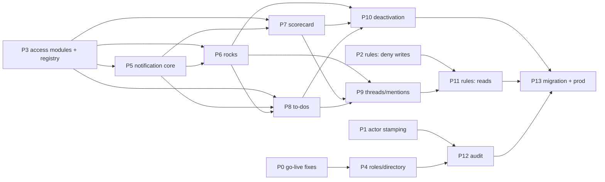

# Permissions build graph

How to take the code from `main` (`2b1eb5c`) to `docs/PERMISSIONS_SPEC.md`
(version 2). Built from six read-only gap audits on 2026-10-09. **Nothing
here is started.**

## Where the code stands

| Area | Already matches | Main gaps |
|---|---|---|
| Roles & directory | Team create/rename and user import are admin-only; leader import; leader role is per team | Leader roster actions exist but **aren't wired to any UI** (`directory/roster-actions.ts`). If wired, a leader could create accounts and promote/demote. Leader import creates placeholder people. Sign-in status is sent to every browser. No last-admin guard. Deactivation **deletes** the account and leaves items owned by a deleted user. |
| Rocks & milestones | Milestone default owner; org-wide milestone assignment; delete limited to parent team; Company flag admin-only; "Shared by" section | No person audience. Audience can't edit. Assignees get the **full rock** (rules, rocks page, L10, Home). Rock owner gets full view and can tick everything. Any member can share or set `team_only`. Lock, `team_only` and `milestone_owner_ids` are still live. Rock owner isn't checked against the roster. |
| To-dos | `created_by` stored; Google Tasks mirrors to the owner | Owner must be on the roster. An off-team assignee **can't open or tick** a to-do (every action is team-gated). The creator can't see a private to-do. Leaders can edit or publish private to-dos. Admins can't see private to-dos in pages. Recap leak. |
| Issues & headlines | Team-only, issue owner on roster | Headlines have no thread |
| Scorecard | Tracking team can't edit; untrack works; no "remove one tracker" action | **No public/private model.** The catalog shows every metric with values to everyone. Any member can pull a private metric. Leaders can't archive or delete. |
| Threads / mentions / follow / notifications | Generic `entity_comments`; the to-do follow, mention and notify path | Everything except comments is **to-do-only**. No registry. Mentions resolve against the roster and never refuse. Notifications store title and snippet copies. No access check at send or at open. No auto-follow. No locked followers or `assigned_by`. |
| Enforcement & rules | **No client writes anywhere** (confirmed). Pure modules for rocks, scorecard, to-dos. | Rules still allow many client writes. Read rules are broader than the server. No modules for team or private items. Audit actor is null on `main` (fix on `fix/c07-actor-stamping`). No admin-view log. All six §7 fixes open. |

## Work packages

Size: S ≈ hours, M ≈ a day, L ≈ several days.

| ID | Package | Spec | Size | Depends on |
|---|---|---|---|---|
| **P0** | **Go-live fixes.** (a) recap private filter; (b) invite doesn't overwrite profiles; (c) `revokeRefreshTokens` on admin change + last-admin guard; (d) allowlist fails closed in prod; (e) directory stops sending sign-in status to non-admins; (f) read-only prod query for "Keep on this team" rocks with outside assignees | §7, §2.5 | 6×S | — |
| **P1** | Merge `fix/c07-actor-stamping` (audit actor on every server write) | §6 | S | — (your call) |
| **P2** | Rules lockdown, phase 1: every client write `false`; drop the consultant email; drop unused `inDomain` reads; add a rules test harness (emulator) covering the ~20 live client reads | §6, §7.4 | M | — |
| **P3** | Access modules + item registry: pure, tested `lib/access/*` for the four shapes, plus `lib/item-registry.ts`. Wraps the existing `rocks-share` / `scorecard-share` / `todo-access`. **No behavior change.** | §3, §5.0, §6 | L | — |
| **P4** | Roles & directory: leader roster UI (add existing directory people, remove); delete the account-creating leader path; promote/demote admin-only; `createOwners` admin-only; per-team role chips | §2 | M | P0b |
| **P5** | Notification core: pointer-only rows, send-time access check, generic `follow(ref)` with auto-follow on comment/mention, locked owner + `assigned_by`, generic peek with "no access" text, `emitEvent(ref, event)`, `purgeItem(ref)` | §5.3 | L | P3 |
| **P6** | Rocks model: audience (teams + persons), leader-only audience and Private, audience can edit (not delete), `team_only` → `private` with guards, stripped assignee view, owner on roster, remove lock and `milestone_owner_ids`, block rule (drop the parent-member exclusion), Home | §3.3, §4 | L | P3, P5 |
| **P7** | Scorecard: `is_public`, catalog filtered to public + own, org metric board, track = public only, private transition (clear trackers, notify leaders), leaders archive/delete, metric follow gated to scorecard | §3.4 | M–L | P3, P5 |
| **P8** | To-dos: org-wide assignment + directory picker; open-by-id route for assignees (complete + comment only); private = creator + assignee + admin; remove leader powers; admins see private; outside-assignee block on the board | §3.1, §3.2 | M–L | P3, P5, **P6** (shares Home and tick path) |
| **P9** | Threads & mentions generic: headline threads, mentions on all types against `canSee`, server refuses others, admin can delete comments, "who can read" line, wire every type's events to `emitEvent` | §5.1, §5.2 | M | P5, P6, P7, P8 |
| **P10** | Deactivation cascade: soft-disable instead of delete (decision D5); unassign owned rocks, milestones, to-dos, issues, metrics, headlines; notify leaders; "Unassigned" display; owner required on save (not issues) | §2.6 | L | P5–P8 |
| **P11** | Rules phase 2: read rules re-derived from the modules (person audience, private to-do creator, item-aware `entity_comments`, `rock_status_updates`, public metrics) + parity tests | §6 | M | P2, P6–P9 |
| **P12** | Access-change audit records + admin-view log | §6 | S–M | P1, P4, P6, P7 |
| **P13** | Migration scripts (all §8 rows) + dry-run report, run against prod **with Daniel** | §8 | M | everything |

## Waves (what can run in parallel)

| Wave | Packages in parallel | Gate before next wave |
|---|---|---|
| 1 | P0 (a–f), P1, P2, P3 | Tests + typecheck green; P0 can ship to prod on its own |
| 2 | P4, P5 | — |
| 3 | P6, P7 | P6 and P7 both touch the L10 page: merge P6 first |
| 4 | P8, then P9 | — |
| 5 | P10, P11, P12 | Full test pass; rules emulator suite green |
| 6 | P13 (dry run → review → prod with Daniel), deploy app + rules together | Your sign-off |

## Shared files (merge in order, never in parallel)

| File | Packages | Rule |
|---|---|---|
| `firestore.rules` | P2, P11 | **Only P2 and P11 edit it.** Other packages write the rule they need into their PR notes. |
| `meetings/[meetingId]/page.tsx` | P0a, P6, P7, P8 | P0a → P6 → P7 → P8 |
| `home/page.tsx`, `lib/home-board.ts` | P6, P8 | P6 → P8 |
| `todos/actions.ts` | P5, P6 (tick), P8 | P5 → P6 → P8 |
| `entity-comments/actions.ts` | P5, P6, P9 | P5 → P6 → P9 |
| `admin/actions.ts` | P0c, P10, P12 | P0c → P10 → P12 |
| `lib/firebase/teams.ts` | P4, P8, P12 | P4 → P8 → P12 |

## How the subagents run

- **Branches:** one integration branch `feat/permissions-v2` off `main`.
  Each package gets its own git worktree and branch off the integration
  branch.
- **Agent brief:** each agent gets a self-contained brief: the spec
  sections, the audit rows, the files it owns, the files it must not touch,
  and "tests + typecheck must pass".
  - Model: Sonnet for S/M packages; Opus for P3, P5 and P6 (the design
    keystones).
- **Review and merge:** I review every package diff, run
  `pnpm typecheck && pnpm test && pnpm lint`, then merge into the integration
  branch in the order above.
- **What needs your approval:** commits, PRs (Bitbucket main with the HPB
  approver), rules deploys, prod scripts and app deploys.

## Decisions (answered by Daniel, 2026-10-09)

| # | Decision | Answer |
|---|---|---|
| D1 | Where does an off-team assignee see to-dos assigned to them? | **Both** Home and the To-Dos page. A private to-do from another team never shows on the team's page, only to the assignee. The row carries a pill: who assigned it and from which team. (P8) |
| D2 | Shared team lists are capped at 8 (rules can't loop). | **Scale to the number of teams in the directory.** The cap exists because each team check costs one document lookup and rules allow at most 10 per read. Fix: keep each user's team list on `users/{uid}.team_ids` (server-maintained on every roster write, plus a backfill) and have the rules do one `get()` + `hasAny()`. Needs a short emulator spike to confirm the live `array-contains` list queries still pass. New package **P14**, wave 1; P2 and P11 use it. |
| D3 | Merge `fix/c07-actor-stamping` (P1)? | **Open it as a PR on GitHub; Daniel merges it.** Check it rebases clean on `main` first. |
| D4 | Remove the consultant email from `firestore.rules`? | **Not yet.** Drop it from P2. |
| D5 | Deactivation: delete or disable? | **Disable** (`auth.updateUser(uid, {disabled: true})`), reversible. (P10; P0c revokes sessions on disable.) |
| D6 | Ship P0 ahead of the rest? | Yes. **Remind Daniel of the P0 list before kickoff** (see "Go-live fixes" below). |

## Go-live fixes (P0), for the kickoff reminder

a. Meeting recap hides private to-dos.
b. Adding someone to a team no longer overwrites their existing profile.
c. `revokeRefreshTokens` on admin-claim change and on disable; last-admin guard.
d. `SIGN_IN_ALLOWLIST` fails closed in production.
e. Directory stops sending sign-in status (`hasAuth`, `hasSignedIn`) to non-admins.
f. Read-only prod script listing "Keep on this team" rocks with outside assignees. **Run locally with Daniel, not from the cloud.**

## Plan review, still to apply (held 2026-10-09)

- Split P6, P7 and P8 into an "a" part (model + server gates, depends on P3 only) and a "b" part (notifications, depends on P5) so wave 2 can run P4, P5, P6a and P7a in parallel.
- PRs straight to `main` (Daniel merges): P0, P1, P2, P14. Everything else lands on `feat/permissions-v2` with one squashed commit per package, then one final PR to `main`.
- Model per agent: Opus for P3, P5, P6a, P8a, P11, P14 (design and rules keystones); Sonnet for everything else; the main session reviews every diff and runs `pnpm typecheck && pnpm test && pnpm lint` before each merge.
