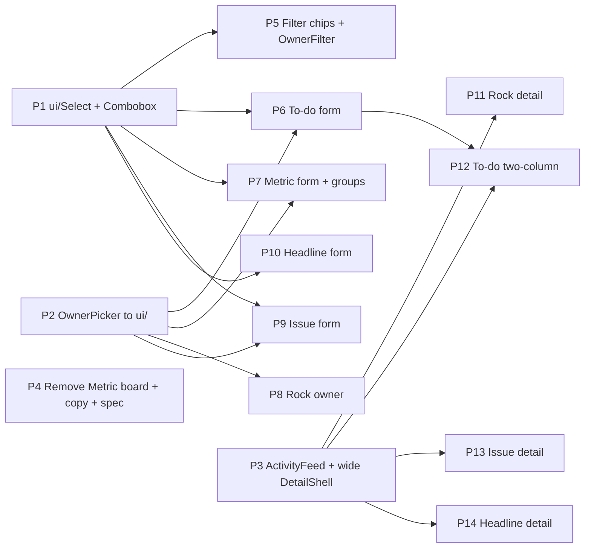

# App walk — 2026-10-13

Daniel walked the app on **`feat/permissions-v2`** (d4c3450). Every file:line
below is from that branch. **Build on `feat/permissions-v2`, not `main`.**
This doc was merged to `main` on its own so a cloud session can read it.
v2 is pushed to `origin/feat/permissions-v2`.

Tags: **ux** / **copy** / **scope change** / **constraint**. Items marked
*(Claude)* were spotted in code, not on the walk. Paths are relative to
`app/(app)/teams/[teamId]/` unless they start with `app/`, `components/` or
`lib/`.

**Contents:** [Build graph](#build-graph) · [Open questions](#open-questions)
· [To-dos](#to-dos) · [Cross-cutting (T3)](#cross-cutting) ·
[Scorecard](#scorecard) · [Rocks](#rocks) · [Issues](#issues) ·
[Headlines](#headlines) · [L10](#l10-cross-boundary--daniel-walks-the-l10-separately-later)

## Build graph

Four waves. Within a wave, PRs are independent and can run in parallel
(separate worktrees). Each PR goes through `pr-wave` one at a time into
`feat/permissions-v2`.

**Rule for every PR (X1):** if the component also renders in the L10, test it
on a live meeting page too (see the X1 table for which segment). Watch modal
stacking/Escape, private to-dos never on the L10, and the forced-team
visibility when created from a meeting.

### Wave 0 — foundations (parallel)
| PR | Items | What | Size |
|---|---|---|---|
| **P1** | T3 | New `components/ui/select-menu.tsx` (custom Select: trigger, popover listbox, keyboard nav, type-ahead, portal so it isn't clipped inside modals, `size` + pill-trigger variant for filters) and a **Combobox** variant (pick existing or type new, for S3 Group). Unit tests + a11y (role=listbox, aria-activedescendant). | M |
| **P2** | T1, R2, S6, I2 | Move `rocks/owner-picker.tsx` to `components/ui/owner-picker.tsx` and update imports (milestones, `todos/todo-owner-field.tsx`). Add an optional **Unassigned** row (issues) and a field-width variant for use as a main Owner field. No behavior change for the current callers. | S |
| **P3** | R3 (T4, I1, H1) | Shared `components/activity-feed.tsx`: one newest-first timeline that merges `EntityComments` data with `lib/activity` events; **+ Comment** button expands the existing rich-text editor at the top. Plus a wide two-column detail shell (`ModalShell` around `5xl`: left details, about 360px right rail, columns scroll separately, stacks below `md`). Not wired into any page yet. | L |
| **P4** | S2, S5 | Delete `app/(app)/metrics/` (page + `track-button.tsx`), the nav link `components/app-shell.tsx:75`, and `loadPublicMetricBoard` if unused. Rewrite the Public help text (`scorecard/metric-form-modal.tsx:~488`). Update `docs/PERMISSIONS_SPEC.md` §3.4. Keep `is_public` and tracking via Add-existing-metric. **Blocked on the S5 open question** (default (a)). | S |

### Wave 1 — swap in the components (parallel, after P1/P2)
| PR | Items | What | Deps |
|---|---|---|---|
| **P5** | S4, S3 (chip), R1, I3, S1 | Rebuild `FilterSelect` (`components/scorecard/scorecard-filters.tsx:21`) and `components/owner-filter.tsx` on P1's pill variant. This covers Scorecard, Rocks, Issues, Headlines and To-dos filters. Also swap `scorecard/add-existing-metric-modal.tsx:273` "Add to group" (S1). | P1 |
| **P6** | T1, T2 | To-do form: widen `add-todo-modal.tsx` / `edit-todo-modal.tsx` (the shared create-modal width, about `3xl`, decide once and reuse in P7/P9). Owner gets a full row; Visibility becomes a custom control (`todo-form-fields.tsx:251`) with spec wording, still hidden on L10 create. | P1, P2 |
| **P7** | S6, S3 | Metric form: wider, Owner → OwnerPicker (`:433`), Interval/Unit/Yes-No/Operator → custom (`:340,:371,:391,:408`), Group datalist → Combobox. `scorecard/manage-groups.tsx:134` Period → custom. | P1, P2 |
| **P8** | R2 | `rocks/rock-modal.tsx:715` owner → OwnerPicker. | P2 |
| **P9** | I2 | `issues/issue-form-modal.tsx` Owner (Unassigned) / Priority / Term → custom; same create width. | P1, P2 |
| **P10** | H2 | `headlines/headline-form-modal.tsx:203` Category → custom with category pill colors. | P1 |

### Wave 2 — detail modals on the activity feed (parallel, after P3)
| PR | Items | What | Deps |
|---|---|---|---|
| **P11** | R3 | `rocks/rock-detail-modal.tsx` on the wide shell. Status history (`:325`) and comments (`:394`) move into the feed. L10: `segment-rocks` comes along via `RockRow`. | P3 |
| **P12** | T4 | `edit-todo-modal.tsx` becomes two-column: form left, feed right. Remove the inline comment expansion from `todo-list-row.tsx:363`; a row opens the modal. L10: `segment-todos`. Mark ROADMAP N64 as superseded. | P3, P6 |
| **P13** | I1 | `issues/issue-detail-modal.tsx` on the shell, issue events in the feed. Edit stays a separate modal (open question). L10: `segment-issues`. | P3 |
| **P14** | H1 | New `headlines/headline-detail-modal.tsx`: full description left, feed right; opens from the page row **and** from `segment-headlines.tsx`. Retire the inline `headline-thread.tsx` toggle. | P3 |

### Wave 3 — leftovers
- The T3 rows still marked **keep?** (see table), plus the native date picker
  decision (3 `type="date"` inputs).
- Daniel's L10 walk (agenda, ratings, recap) produces its own items.

## Open questions

Defaults are in **bold**; the build proceeds on the default unless Daniel
says otherwise.

1. **S2/S5 Metric board:** (a) remove the board and point the Public text at
   the scorecard's "Add existing measurable" search, possibly renamed
   "Public metrics" — **default**; or (b) keep the board and only reword.
2. **S3:** which group dropdown was meant? **Fix all three.**
3. **I1:** issue detail and edit — **keep separate (like Rock)**, or merge like
   to-dos (T4)?
4. **T4:** **the inline comment expansion on to-do rows goes away; Add to-do
   stays one column.**
5. **T3 keep rows:** inline Yes/No cell, directory leader picker, import
   mapping — **keep native** unless flagged.
6. **Dates:** native `type="date"` — **keep for now**, decide in wave 3.

## To-dos

### T1 — Add To-do modal is cramped; owner picker compressed · ux
- **Walk note:** "add to-do modal truncated, so the owner modal is compressed
  when opening, want to mimic rock creation/edit behavior on modal size and
  dropdown size, that appears to be fine"
- **Code (v2):**
  - `todos/add-todo-modal.tsx:170` and `edit-todo-modal.tsx:187`: both use
    `ModalShell size="lg"`. Rock uses `size="5xl"` (`rocks/rock-modal.tsx:604`).
  - `todos/todo-form-fields.tsx:234`: Owner sits in one column of a
    `grid-cols-2` row next to Visibility. On v2 the Owner field is
    `todo-owner-field.tsx`, which reuses the milestone `OwnerPicker` (tabs:
    this team / Whole org, people listed with their teams). Squeezed into
    half of a narrow modal, that picker is the "compressed" view.
  - On Rock the full-size `OwnerPicker` only appears on milestone rows
    (`rock-modal.tsx:811`) in a wide modal, which is why it looks fine.
    Rock's main Owner field is a native `<select>` (`:715`).
- **Fix direction:** widen the to-do modal toward Rock's size, give Owner a
  full-width row, and make the picker's popover match the milestone picker's
  size. `TodoFormFields` is shared, so this fixes Add and Edit together.

### T2 — Visibility dropdown should be custom in to-do Create and Edit · ux
- **Walk note:** "visibility dropdown needs to be custom for to-do create/edit"
- **Code (v2):** `todos/todo-form-fields.tsx:251`: native `<Select>`, Team / Private
- **Fix direction:** a custom control. With only two options, a segmented
  toggle or a dropdown with an icon and a one-line explanation would fit (for
  example "Private — only you and the owner"). The wording should follow the
  permissions spec (2026-10-09, Private = least privilege). Shared fields, so
  Add and Edit are both covered.
- **Depends on:** T1 (same form, same layout pass).

### T4 — To-do modal on the To-dos page → two-column with activity feed · ux / layout
- **Walk note:** "let's make the to-do modal on the to-dos page two column as
  well" (following R3)
- **Code (v2):** today a to-do is split across two places:
  - `todos/edit-todo-modal.tsx`, `size="lg"` (`:187`): form fields only, no
    comments
  - `todos/todo-list-row.tsx:363`: comments live in the inline row
    expansion (`EntityComments entityType="todo"`)
- **Fix direction:** same shell as R3. Wide two-column modal: `TodoFormFields`
  on the left (this also settles T1's width, since Owner gets a full row), and
  the shared `ActivityFeed` on the right (comments + to-do events, newest
  first, "+ Comment" collapsed at the top).
- **Supersedes ROADMAP N64's "expansion view instead of modal":** Daniel now
  wants a modal, not an expansion. N64's "+ Comment" and activity feed parts
  are done by this item.
- *(Claude)* Assumption: the row's inline comment expansion goes away and
  opening a to-do takes you to this modal. Add to-do stays one column (there's
  no history yet), but at the new width.
- **Depends on:** R3 (`ActivityFeed`), T1/T2.

## Cross-cutting

### T3 — Native dropdown inventory: keep or replace · ux
- **Walk note:** "scan for sys default dropdowns, there will be cases to keep
  defaults and to update"
- `<Select>` in `components/ui/input.tsx:45` is a thin wrapper around the native
  element, so every row below opens the browser's default menu. The only
  custom dropdowns today are `rocks/owner-picker.tsx` (and
  `todos/todo-owner-field.tsx`, which wraps it) and
  `components/ui/multi-select.tsx`.
- **Inventory on v2 (re-run 2026-10-13):** 22 native selects + 1 datalist.
  "Decided" = Daniel said so on the walk.

| # | Where (v2) | Controls | Call | Item / PR |
|---|---|---|---|---|
| 1 | `todos/todo-form-fields.tsx:251` | To-do visibility | **custom**, decided | T2 / P6 |
| 2 | `rocks/rock-modal.tsx:715` | Rock owner | **OwnerPicker**, decided | R2 / P8 |
| 3 | `issues/issue-form-modal.tsx:231` | Issue owner (Unassigned + members) | **OwnerPicker**, decided | I2 / P9 |
| 4 | `issues/issue-form-modal.tsx:248` | Issue priority | **custom**, decided | I2 / P9 |
| 5 | `issues/issue-form-modal.tsx:266` | Issue term (Short/Long) | **custom** or segmented, decided | I2 / P9 |
| 6 | `scorecard/metric-form-modal.tsx:340` | Metric interval | **custom**, decided | S6 / P7 |
| 7 | `scorecard/metric-form-modal.tsx:371` | Metric unit | **custom**, decided | S6 / P7 |
| 8 | `scorecard/metric-form-modal.tsx:391` | Yes/No goal | **custom**, decided | S6 / P7 |
| 9 | `scorecard/metric-form-modal.tsx:408` | Goal operator | **custom**, decided | S6 / P7 |
| 10 | `scorecard/metric-form-modal.tsx:433` | Metric owner | **OwnerPicker**, decided | S6 / P7 |
| 11 | `scorecard/metric-form-modal.tsx:~460` | Group (`<datalist>`) | **Combobox**, decided | S3 / P7 |
| 12 | `scorecard/manage-groups.tsx:134` | Group period | **custom** (S3 default) | S3 / P7 |
| 13 | `scorecard/add-existing-metric-modal.tsx:273` | "Add to group" under Search measurables | **custom**, decided | S1 / P5 |
| 14 | `components/scorecard/scorecard-filters.tsx:52` | `FilterSelect`: Date range, Group, Status, Owner, Sort | **custom**, decided | S4 / P5 |
| 15 | `components/owner-filter.tsx:44` | Owner filter: Rocks, Issues, Headlines, To-dos | **custom**, decided | R1, I3 / P5 |
| 16 | `headlines/headline-form-modal.tsx:203` | Headline category | **custom**, decided | H2 / P10 |
| 17 | `scorecard/value-cell.tsx:202` | Inline Yes/No value cell | keep? native is faster when typing in values | wave 3 |
| 18 | `app/(app)/directory/directory-leader.tsx:105` | Add to team → Team | keep? | wave 3 |
| 19 | `app/(app)/directory/directory-leader.tsx:128` | Add to team → Person | keep? (OwnerPicker fits) | wave 3 |
| 20–23 | `import/import-uploader.tsx:264,301,387,466` | Import: team, column mapping, unknown owners | keep (admin tool) | — |

- *(Claude)* There are also three native date pickers (`type="date"`, e.g.
  the to-do due date). Wave 3.

## Scorecard

### S1 — Cadence dropdown in the metric search should be custom · ux
- **Walk note:** "scorecard cadence on the metrics search on the scorecard page"
- **Read as:** the "Add to group — Matching cadence (Weekly, Monthly…)" native
  select directly under "Search measurables" in the Add-existing-metric
  modal, `scorecard/add-existing-metric-modal.tsx:273`. (The interval
  Weekly/Monthly/… switch on the page itself is already custom tabs,
  `components/scorecard/scorecard-filters.tsx:211`.)
- **Fix direction:** swap to the shared custom Select (T3 row 13).
- **Depends on:** T3 shared component.

### S2 — Remove the org Metric board page; metrics live on team scorecards · scope change
- **Walk note:** "there appears to be a metric board page now, we do not want a
  separate metric board page, but adding a metric will show on a team's
  scorecard page"
- **Code (v2 only, from 60bfcee "Scorecard: is_public, … org metric board"):**
  - `app/(app)/metrics/page.tsx`: lists every public metric org-wide, with an
    "Add to <team>" button per team (`metrics/track-button.tsx` →
    `addExistingMetric`)
  - `components/app-shell.tsx:75`: "Metric board" link in the side nav
  - `lib/firebase/scorecard-catalog.ts` `loadPublicMetricBoard`
- **This conflicts with the spec:** `docs/PERMISSIONS_SPEC.md` §3.4 (Shape D)
  says "A public metric shows on the metric board of the organization." The
  spec needs updating along with the code.
- **Fix direction:** delete the `/metrics` route, the nav link and
  `track-button`, plus `loadPublicMetricBoard` if nothing else uses it.
  Keep `is_public` and tracking: on a team's scorecard, the
  Add-existing-metric modal (search measurables) remains the way to pull in
  another team's public metric. Update §3.4 to say public metrics can be found
  through scorecard search, and that there is no board.
- **Open:** once the board is gone, what does "Public" mean? It probably
  becomes "findable and trackable by other teams from their scorecard." That
  should go into the spec wording.

### S3 — Scorecard groups dropdown is browser-default · ux
- **Walk note:** "scorecard groups dropdown is default, needs updates"
- **Code (v2): three group dropdowns, all browser-default:**
  - `components/scorecard/scorecard-filters.tsx:299`: "All groups" filter chip
    (`FilterSelect`, covered by S4 too)
  - `scorecard/metric-form-modal.tsx:~460`: Create metric → Group (optional)
    is an `<Input list=…>` + `<datalist>`, so it shows the browser's
    autocomplete popup. This needs a custom combobox (pick an existing group
    or type a new one), not a plain select.
  - `scorecard/manage-groups.tsx:134`: Groups modal → Period `<Select>`
- **Fix direction:** shared custom Select (T3) for the filter and Period; a
  shared custom combobox for the Group field.
- **Open:** which of these did you see? Fixing all three is the default.

### S4 — Scorecard filter chips are browser-default · ux
- **Walk note:** "scorecard filters dropdown are default, need updated"
- **Code (v2):** `components/scorecard/scorecard-filters.tsx:21` `FilterSelect`
  renders all five chips: Date range (`:279`), Group (`:299`), Status (`:315`),
  Owner (`:329`), Sort (`:344`). It's a styled native `<select>`, so the menu
  that opens is the browser's own.
- **Fix direction:** rebuild `FilterSelect` internals on the shared custom
  Select and keep the pill trigger look. One component swap fixes all five.
  `components/owner-filter.tsx:44` (the owner filter on the other list pages)
  should match.
- **Depends on:** T3 shared component.

### S5 — Public flag wording on Create metric · copy
- **Walk note:** "public flag needs updated on the create [metric], should say,
  team's can pull this metric from public metric board"
- **Code (v2):** `scorecard/metric-form-modal.tsx:~485`. Current text: "Everyone
  can see it on the metric board and other teams can track it. Private by
  default."
- **Conflict with S2:** S2 removes the org Metric board page. If the board is
  gone, this text needs to name wherever teams actually pull a metric from.
  Today that's the "Add existing measurable" search on their own scorecard
  (`add-existing-metric-modal.tsx`).
- **Open:** is "public metric board" the name for that search modal (maybe
  rename the modal to match), or should the board stay after all?

### S6 — Create metric modal: larger, custom dropdowns · ux
- **Walk note:** "the create modal can be larger and those dropdowns can get
  customed"
- **Code (v2):** `scorecard/metric-form-modal.tsx:313` `size="lg"`. Dropdowns:
  Interval `:340`, Unit `:371`, Yes/No goal `:391`, Goal operator `:408`,
  Owner `:433` (native, team members only), Group datalist (see S3).
- **Fix direction:** match T1, a wider size shared with the to-do modals.
  Owner → `OwnerPicker` (as on to-dos in v2). The rest → shared custom
  Select. This overrides my T3 "keep" suggestion for the unit, goal and
  operator rows, since Daniel wants this modal fully custom.
- **Depends on:** T3 shared components; T1 (modal size decision).

## Rocks

### R1 — Rocks page owner filter → custom · ux
- **Walk note:** "rocks user dropdown custom"
- **Code (v2):** `rocks/page.tsx:515` → `components/owner-filter.tsx:44` (native).
  This is the same component as T3 row 15. To-dos and other list pages share it.
- **Fix direction:** shared custom Select (T3); matches S4 filter chips.

### R2 — Add Rock owner → custom · ux
- **Walk note:** "add rock owner dropdown custom"
- **Code (v2):** `rocks/rock-modal.tsx:715` native `<select>`. The modal already
  uses `OwnerPicker` on milestone rows (`:811`).
- **Fix direction:** use `OwnerPicker` for the rock owner as well, which
  matches T1/S6.

### R3 — Rock detail: comments → right-side activity feed; editor behind "+ Comment" · ux / layout
- **Walk note:** "on the rock modal, can we pull the comments out into a right
  side bar activity feed, which is discussed elsewhere, might be in the
  to-dos. the RTE should collapse to a + comment" (screenshot: Achieve SOC 2,
  Status history and Comments stacked under Milestones)
- **Code (v2):** `rocks/rock-detail-modal.tsx`, `size="lg"` (`:190`), Status
  history (`:325`), `EntityComments` (`:394`, always-open editor + Post).
- **Prior art:** ROADMAP **N64** (W3, not started) is the same ask for
  to-dos: expansion view, comment editor collapsed behind **+ Comment**,
  activity feed. Its finding: comments already cover issue/rock/todo
  (`entity-comments/actions.ts`), and an activity model exists
  (`lib/activity.ts`, `lib/firebase/activity.ts`), so it's "layout and
  wiring, not a new surface."
- **Note:** N33 records Daniel disliking the *in-meeting* right sidebar.
  That was about meeting chrome, not item detail, so it doesn't conflict.
- **Fix direction:** build one shared `ActivityFeed` (comments + events,
  collapsed composer) for rock detail first, then reuse it for N64.
- **Decided (Daniel, 2026-10-13):**
  - **Content:** one timeline covering comments and events: status changes
    with notes (replaces the Status history section), milestones done, and
    owner/due changes. Uses `lib/activity`.
  - **Layout:** wide two-column modal (about `5xl`, like Rock edit). Details
    on the left, feed about 360px on the right, each column scrolls on its
    own. On narrow screens the feed stacks below.
  - **Order:** newest first. **+ Comment** sits at the top of the feed and
    expands into the rich-text editor.
  - **Scope:** a shared `ActivityFeed` component, shipped on rock detail
    first, then reused for to-dos (T4), issues (I1) and headlines (H1).

## Issues

### I1 — Issue detail → two-column with activity feed and improved comment UI · ux / layout
- **Walk note:** "let's add the same thing to issues (improved comment UI and
  right side bar with comments and activity"
- **Code (v2):** `issues/issue-detail-modal.tsx`. `DetailModal size="lg"`
  (`:104`) with `EntityComments` stacked inside (`:184`). Edit is a
  separate modal, `issue-form-modal.tsx` (`size="lg"`, `:205`).
- **Fix direction:** same shell as R3/T4. Details on the left, shared
  `ActivityFeed` on the right (comments + issue events: status/solve,
  owner change, term move, votes, newest first, "+ Comment" collapsed).
- **Depends on:** R3 (`ActivityFeed`).
- **Open:** issues have a separate detail modal and edit modal (like rocks,
  unlike to-dos). Keep them separate as on Rock, or merge them like T4?
  The default is to keep them separate, matching Rock.

### I2 — Create/Edit issue modal → custom dropdowns · ux
- **Walk note:** "Create issues modal needs custom dropdowns"
- **Code (v2):** `issues/issue-form-modal.tsx`, three native `<Select>`s:
  Owner (`:231`, Unassigned + team members), Priority (`:248`, None + levels),
  Term (`:266`, Short-term/Long-term). Modal is `size="lg"` (`:205`).
- **Fix direction:** Owner → `OwnerPicker` with an "Unassigned" option
  (matching R2/S6/T1). Priority and Term → shared custom Select. A
  segmented toggle would also suit Term, since it has only two options.
  The form is shared, so Create and Edit are both covered. Use the same
  modal width as the other create modals.
- **Depends on:** T3 shared components.

### I3 — Issues page owner filter → custom · ux
- **Walk note:** "user dropdown on issues page needs custom dropdowns"
- **Code (v2):** the shared `components/owner-filter.tsx:44`, the same
  component as R1. One fix covers Issues, Rocks and every other page that
  uses it.
- **Depends on:** T3; same PR as R1.

## Headlines

### H1 — New headline detail modal: big, full description, activity feed · ux / new surface
- **Walk note:** "Need a big headlines modal, opening shows full description,
  same activity/comments side bar here as well"
- **Code (v2):** there is no headline detail modal today. Everything is inline
  on `headlines/page.tsx`:
  - `headline-body.tsx:50`: description clamped to one line (`line-clamp-1`)
    with an inline expand toggle (`:33`)
  - `headline-thread.tsx`: a comments toggle that expands `EntityComments`
    inline (`:38`, `:49`), rendered from `page.tsx:162`
  - `headline-form-modal.tsx`: create/edit, already `size="4xl"` (`:174`)
- **Fix direction:** new `HeadlineDetailModal` on the R3 shell. A wide
  two-column modal opens from the row. Left: title, type/audience, owner,
  the **full description** (not clamped), and an Edit action. Right: shared
  `ActivityFeed` (comments + headline events, newest first, "+ Comment"
  collapsed). The row keeps its one-line preview, and the inline thread
  toggle goes away.
- *(Claude)* Headline events are thinner than other items (created, edited,
  owner change, done). P9 added a headline thread type, so comments are
  already wired.
- **Depends on:** R3 (`ActivityFeed`).

### H2 — Create/Edit headline → custom dropdowns · ux
- **Walk note:** "custom dropdowns in create headline"
- **Code (v2):** `headlines/headline-form-modal.tsx:203`. The only dropdown
  is **Category** (native `<Select>` over `KIND_OPTIONS`, `:19`). No owner
  field; the modal is already `size="4xl"`.
- **Fix direction:** shared custom Select (T3). Each category could show its
  pill color in the menu. Create and Edit share the form.
- **Depends on:** T3.

## L10 (cross-boundary) — Daniel walks the L10 separately later

### X1 — L10 segments must pick up every change above · constraint
- **Walk note:** "we want to replicate the styling behavior for the L10 pieces
  that cross the boundary, so that needs to be solved for as well, i will walk
  the l10 another time"
- **Rule for every PR in this graph:** if a component also renders inside the
  L10, the change has to look and work right there too. Check the meeting
  page as part of each PR's test, not as follow-up work.
- **Where the L10 reuses page components (v2, `meetings/[meetingId]/`):**
  | Segment | Reuses | Inherits |
  |---|---|---|
  | `segment-rocks.tsx` | `RockRow`/`RockBlockRow` → `RockDetailTrigger` (`rocks/rock-row.tsx:176`) | R3 detail modal automatically |
  | `segment-todos.tsx` | `TodoListRow` (`:532`), `AddTodoModal` (`:42`) | T1/T2/T4; the inline comment expansion goes away here too |
  | `segment-issues.tsx` | `IssueDetailTrigger`, `IssueFormModal`, `AddTodoModal` | I1/I2, T1/T2 |
  | `segment-headlines.tsx` | `HeadlineBody` (inline clamp), `HeadlineFormModal` | H2 automatically; **H1 needs wiring**: the segment renders headlines inline, so the new detail modal has to be opened from the segment row too |
  | `segment-scorecard.tsx` | `ScorecardPanel` → `ScorecardFilters` | S3/S4 automatically |
- **Watch-outs:**
  - Modal stacking during a live meeting. A wide two-column modal opens over
    the meeting page, so check z-order and Escape against the meeting's own
    panels.
  - Private to-dos never show on the L10 (3cb9733). The feed and modal must
    not provide a way around that.
  - To-do modal opened from the L10 with `meetingId`: visibility is hidden
    and forced to team (`todo-form-fields.tsx` `showVisibility`). T2's custom
    control has to respect this.
- **Open:** anything that only exists in the L10 (agenda, ratings, recap) is
  left for Daniel's L10 walk.
